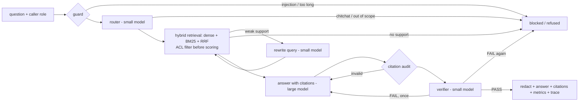

# Enterprise Knowledge Agent

A retrieval-augmented agent that answers employee questions over **structured and unstructured** company data, with **access control enforced in retrieval**, **cited and self-verified answers**, **LLM-native tracing** (tokens, tokens/sec, TTFT, cost-per-request), an **evaluation harness**, and a **Gemini / Vertex AI + Cloud Run** deployment path.

It refuses when it should: if the corpus cannot support an answer, or an answer cannot be verified against the chunks it cites, the agent says so instead of guessing.

## How a question is answered



Details: [docs/ARCHITECTURE.md](docs/ARCHITECTURE.md). Security model: [docs/SECURITY.md](docs/SECURITY.md).

## Quick start (offline, no keys)

```bash
python -m kagent.cli ask "How many days of annual leave do full-time employees get?"
python -m kagent.cli ask "What is the salary band for level L4?"             # refused: HR-only document
python -m kagent.cli ask "What is the salary band for level L4?" --role hr   # answered
python -m kagent.evalrun                                                      # evaluation + ablation table
python -m pytest -q                                                           # 76 tests
python -m mypy kagent
KB_TOKENS=tok-emp=employee,tok-hr=hr python -m kagent.server                  # HTTP service on 127.0.0.1:8080
```

The runtime needs only the Python 3.10+ standard library. By default a deterministic mock model and offline hash embeddings are used.

## HTTP API

| Method & path | Purpose |
|---|---|
| `POST /v1/ask` | `{"question": "...", "trace"?: true}` -> `{status, answer, reason, citations[], metrics, verified, ...}` |
| `GET /healthz`, `GET /readyz` | liveness; readiness (index is loaded) |
| `GET /metrics` | Prometheus: requests by status, tokens, cost, latency, indexed chunks |

The caller's **role comes from the bearer token** (`KB_TOKENS=token=role,...`), never from the request body, so a caller cannot grant itself access. On Cloud Run, IAM authenticates callers and everyone gets `KB_DEFAULT_ROLE`.

## Data and retrieval

- **Unstructured:** Markdown/text, chunked by heading then paragraph with one-sentence overlap; every chunk is embedded with a `Title > Section` header.
- **Structured:** each CSV row becomes a chunk (`plan: Pro; price_usd_per_month: 299; ...`) and is cited like any document.
- **Hybrid retrieval:** dense vectors + BM25, fused with Reciprocal Rank Fusion; an IDF-weighted *support* score gates refusals.
- **Access control:** per-document `acl:` front matter (CSV: `.acl` sidecar). Disallowed chunks are filtered before scoring, so they are never ranked or sent to the model.
- **Incremental ingestion:** unchanged chunks are not re-embedded; deleted documents are removed; changing the embedding model re-embeds everything.
- **Vector store:** exact cosine search over SQLite (fine to ~10^5 chunks). The `VectorStore` protocol is the seam for Vertex AI Vector Search or AlloyDB pgvector.

## Evaluation (offline run: 60 questions, 39 chunks)

Categories: answerable (direct, structured, paraphrased, deliberately hard synonyms), unanswerable, access-restricted, prompt-injection.

| config | answer acc | hit@1 | hit@4 | MRR | refuse OK | ACL OK | ACL leaks | inject OK | cited |
|---|---:|---:|---:|---:|---:|---:|---:|---:|---:|
| vector_only | 73% | 92% | 96% | 0.929 | 100% | 100% | 0 | 100% | 100% |
| bm25_only | 75% | 94% | 96% | 0.948 | 100% | 100% | 0 | 100% | 100% |
| hybrid | 75% | 88% | 96% | 0.917 | 100% | 100% | 0 | 100% | 100% |
| hybrid+rewrite | 75% | 94% | 96% | 0.948 | 100% | 100% | 0 | 100% | 100% |
| hybrid+rewrite+verify | 75% | 94% | 96% | 0.948 | 100% | 100% | 0 | 100% | 100% |
| full (routing) | 75% | 94% | 96% | 0.948 | 100% | 100% | 0 | 100% | 100% |

**Read this honestly.** The embeddings are an offline **hashing** model (lexical only, no synonyms) and the answerer is an **extractive mock**. So:
- The safety rows (refusals, ACL, injection, citations) test the pipeline's real logic and hold at 100%.
- The 75% answer accuracy is dominated by the 10 deliberately hard synonym questions (e.g. "thumb drive" vs "USB storage") that lexical retrieval cannot match; every failure is listed in [results/eval.md](results/eval.md). Real embeddings should help; that is **unverified** until you run it.
- Hybrid is **not** better than BM25 alone on this small, keyword-friendly corpus. That is a result, not a bug; the point of the harness is to measure it on your own data.
- Latency and prices are simulated placeholders: do not quote cost or latency from this table.

Run it with real models: `python -m kagent.evalrun --llm gemini --embed gemini --limit 20` (see below).

## Using Gemini (AI Studio or Vertex AI)

`kagent/gemini.py` is a dependency-free client for generation (streaming; TTFT measured at the first streamed part; tokens from `usageMetadata`) and embeddings. Model ids and prices are required so nothing stale is hard-coded and cost-per-request is real:

```bash
export KB_LLM=gemini
export GEMINI_API_KEY=...                  # AI Studio; or for Vertex: KB_GEMINI_BACKEND=vertex GOOGLE_CLOUD_PROJECT=... GOOGLE_CLOUD_LOCATION=...
export KB_MODEL_SMALL=<model id>  KB_MODEL_LARGE=<model id>  KB_EMBED_MODEL=<embedding model id>
export KB_PRICE_SMALL="in,out"    KB_PRICE_LARGE="in,out"     # USD per 1M tokens, from the pricing page
python -m kagent.evalrun --llm gemini --embed gemini --limit 20
```

## Deploy to Cloud Run

```bash
PROJECT_ID=my-project KB_MODEL_SMALL=... KB_MODEL_LARGE=... KB_EMBED_MODEL=... KB_PRICE_SMALL=... KB_PRICE_LARGE=... ./deploy/cloudrun.sh
```

Deploys from source with a dedicated service account (`roles/aiplatform.user`), no API keys, `--no-allow-unauthenticated`, concurrency 8. See [docs/DEPLOY.md](docs/DEPLOY.md).

## Google ADK

`kagent/adk_agent.py` exposes the same retriever as a read-only ADK tool under an `LlmAgent` (`pip install google-adk`). It was written from the ADK docs and **has not been run**.

## Verification status

| Verified in the build environment | Not verified (needs you) |
|---|---|
| 76 tests pass on Python 3.13; `mypy` clean | Any live Gemini / Vertex call (clients tested against a local fake server over real HTTP/SSE for both backends) |
| Live server smoke test with `curl`: auth, roles, refusal vs answer, metrics, SIGTERM drain (also a test) | Real-embedding retrieval quality and the real-model eval |
| Offline eval + ablation reproducible | `docker build`, CI workflow, `deploy/cloudrun.sh` (no Docker daemon, no gcloud login here) |
| Access control, injection, budget, outage paths covered by tests | `adk_agent.py`; Python 3.10-3.12; behaviour under real load |

## Known limitations

- The discovery doc ([docs/DISCOVERY.md](docs/DISCOVERY.md)) is a template: the answers must come from a real stakeholder conversation.
- SQLite exact search and an in-process concurrency cap: single-node design. Scale-out path is in the architecture doc.
- The corpus is synthetic (a fictional logistics company). Retrieval numbers say nothing about your data until you run it on yours.
- Injection scrubbing is heuristic; the structural defences matter most (see SECURITY).
